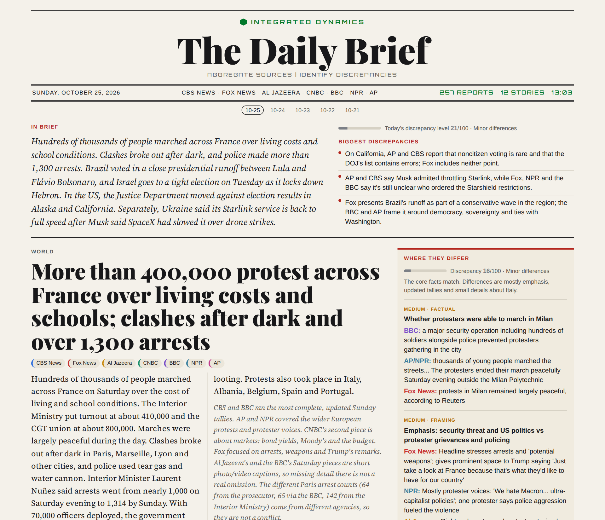
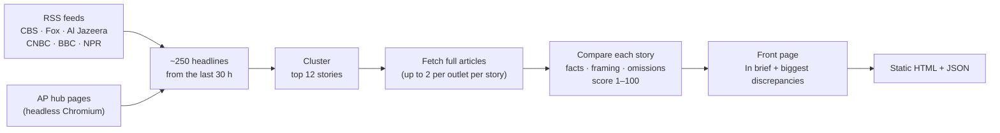

# The Daily Brief

**Seven news outlets, one front page, and a flag wherever their stories don't match.**

Every morning at 5 AM Pacific, this script reads the latest reporting from **CBS News, Fox News, Al Jazeera, CNBC, BBC, NPR and the AP**. It picks the day's biggest stories and lines up how each outlet covered them. Then it flags the places where their accounts differ: a conflicting fact, a different framing, or something one outlet leaves out. The result is published as a newspaper-style front page.

### → Read today's brief: [integrated-dynamics.net/news_brief](https://integrated-dynamics.net/news_brief/)

<picture>
  <source media="(prefers-color-scheme: dark)" srcset="docs/front-page-dark.png">
  
</picture>

## Why

Every outlet makes choices about which facts lead, which voices get quoted, which context gets a sentence and which gets cut. Read one source and you never see those choices. Read seven and you can't keep up. The Daily Brief does the side-by-side reading for you and shows where the accounts diverge, using each outlet's own words, so you can judge for yourself.

It does not rate outlets or label any of them biased. It compares specific stories on a specific day.

## What a discrepancy is

Each story is compared outlet by outlet, and every real difference is filed as one of three kinds:

| Kind | What it means | Example |
|---|---|---|
| **Factual** | The outlets' facts can't both be right: numbers, names, dates, who said what, what a ruling actually says | One outlet says Musk admitted throttling Starlink; others say it's unclear who ordered the restrictions |
| **Framing** | Same facts, materially different emphasis, labels, headline slant or choice of who gets quoted | "Militants" vs "fighters"; leading with arrests vs leading with protesters' grievances |
| **Omission** | A significant fact one outlet includes and another leaves out, where leaving it out changes the impression | Two outlets note that noncitizen voting is rare and the DOJ's list contains errors; a third mentions neither |

Every flag shows each outlet's version (quoted where possible), a likely explanation (articles published hours apart, different official sources, editorial framing) and a significance rating.

What it deliberately **doesn't** flag: tallies that climb as officials update them, rounding, figures from different agencies, or one outlet simply giving more detail. Fewer, real flags beat many small ones. When the outlets agree, the brief says so.

### The discrepancy score

Each story gets a **1–100 score** for how much the accounts actually conflict, judged as a whole rather than by counting flags. The day's score is the average across stories.

| Score | Band |
|---|---|
| 1–10 | Sources align |
| 11–30 | Minor differences |
| 31–60 | Notable differences |
| 61–85 | Conflicting accounts |
| 86–100 | Contradictory |

## How it works



1. **Collect.** It pulls every item published in the last 30 hours from each outlet's RSS feeds. The AP has no public RSS and sits behind a Cloudflare check, so its hub pages are read in headless Chromium, with a fresh browser context for each page.
2. **Cluster.** Claude picks the 12 most significant stories, preferring ones covered by three or more outlets, and groups every item about the same specific event. It merges overlapping stories and skips lifestyle, shopping and opinion pieces.
3. **Read.** For each story it fetches the full text of up to two articles per outlet with [trafilatura](https://github.com/adbar/trafilatura). If an article can't be fetched it falls back to the feed summary, and the analysis is told so, so a short summary isn't mistaken for an omission.
4. **Compare.** Claude reads each story's articles side by side. It writes a neutral headline and summary, the facts the outlets agree on, every discrepancy with each outlet's version, claims only one outlet reports, and the 1–100 score.
5. **Write the front page.** It writes an 80-word "In brief", picks up to three of the day's most consequential discrepancies, and renders everything as a static newspaper page with light and dark themes. The four biggest stories go on the front page and the rest under "Also today", each with a full outlet-by-outlet comparison.

All model calls go through the [Claude Code](https://docs.anthropic.com/en/docs/claude-code) CLI in headless mode (`claude -p`), with a JSON schema for every step, so the output is structured data rather than free text. A run makes about 14 calls: one to cluster, one per story, and one for the front page.

## Run it yourself

Requirements: Python 3.11+ (developed on 3.14), the [Claude Code CLI](https://docs.anthropic.com/en/docs/claude-code) installed and logged in, and Chromium for Playwright.

```bash
git clone https://github.com/zakelectric/news_brief.git
cd news_brief
python -m venv venv && . venv/bin/activate
pip install -r requirements.txt
playwright install chromium

python news_brief.py run                          # fetch, analyze, render today's brief
python -m http.server -d site 8088                # then open http://localhost:8088
```

| Command | What it does |
|---|---|
| `run [--date YYYY-MM-DD]` | Fetch, cluster, compare and render |
| `render [--date ...]` | Rebuild the HTML from the saved JSON |
| `overview [--date ...]` | Rewrite only the front-page brief, then re-render |
| `reanalyze [--date ...]` | Refetch the saved stories' articles and redo the comparison |
| `publish` | Copy the pages to integrated-dynamics.net and deploy (specific to that site) |

Output goes to `site/`: one HTML page per day plus `index.html` for the latest, and the full analysis as JSON in `site/data/`. `run_daily.sh` is the cron entry point (`0 5 * * *`).

To change the outlets, edit `SOURCES` at the top of `news_brief.py`. Any RSS feed works.

## Limits

- It compares what the outlets published in their feeds over the last 30 hours, not their full coverage, and it reads at most two articles per outlet per story.
- The analysis is done by a language model. It is instructed to quote the outlets and not invent disagreements, and every flag shows the outlets' own words so you can check. It can still be wrong. Each story links back to the original articles.
- The summaries paraphrase the outlets' reporting. Read the originals for anything that matters.

## License

The code is [MIT licensed](LICENSE). The generated briefs paraphrase and quote the outlets' reporting, which remains theirs.

---

Built by [Integrated Dynamics](https://integrated-dynamics.net), a San Diego studio for custom software, automation and hardware.
